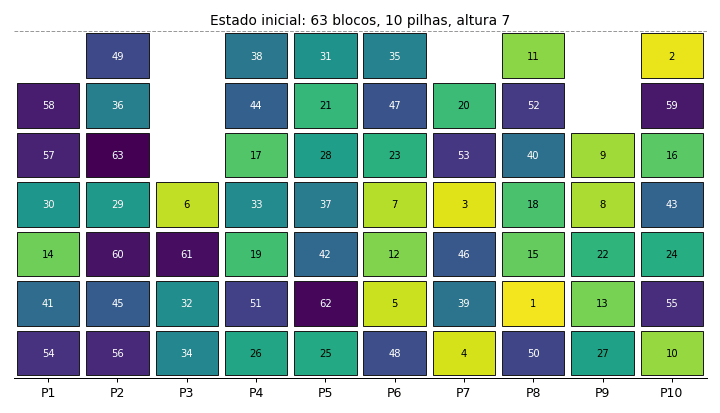

# Block Relocation Problem com Random-Key Optimizer

**Otimização do desempilhamento de contêineres e blocos com meta-heurísticas de chaves aleatórias (C++ e Python).**

Iniciação Científica com bolsa FAPESP, Engenharia de Produção na UFSCar. Artigo aprovado e apresentado no **ENEGEP 2026** (XLVI Encontro Nacional de Engenharia de Produção). Pôster apresentado no **ONPCE 2026**.



<sub>Solução real encontrada pelo código deste repositório para a instância `7-10-63/11801` do benchmark de Zhu et al. (2012): 63 blocos, 10 pilhas, altura 7, **49 realocações em 10 s**. O bloco em vermelho é o que está sendo realocado.</sub>

---

## O problema

Em pátios de contêineres, depósitos e armazéns verticais, os itens ficam empilhados e só o do topo pode sair. Quando o próximo item a ser retirado está embaixo de outros, os que estão por cima precisam ser movidos para outras pilhas. Cada movimento custa tempo de guindaste, combustível e dinheiro.

O **Block Relocation Problem (BRP)** busca a sequência de movimentos que esvazia o pátio na ordem de prioridade com o **menor número de realocações**. Este trabalho trata a variante restrita (BRP-D), em que só podem ser movidos os blocos que estão em cima do bloco-alvo. O problema é NP-difícil: métodos exatos não escalam para pátios de porte médio e grande.

## A abordagem

O [Random-Key Optimizer (RKO)](https://doi.org/10.1007/s10732-025-09568-z) representa cada solução como um vetor de números em `[0, 1)` e deixa várias meta-heurísticas (SA, ILS, PSO, BRKGA e outras) buscarem nesse espaço contínuo, em paralelo. A conexão com o problema real fica num componente chamado **decoder**.

**Minha contribuição é o decoder para o BRP** ([`cpp/Program/src/Problem/Problem.h`](cpp/Program/src/Problem/Problem.h)):

1. Simula a retirada dos blocos em ordem de prioridade.
2. Sempre que um bloco atrapalha a retirada, a chave aleatória daquele bloco escolhe **qual regra heurística** decide a pilha de destino.
3. Devolve o total de realocações, que as meta-heurísticas tentam minimizar.

| Regra | Ideia |
|---|---|
| Minimizar bloqueios | Evita colocar o bloco em cima de outros que vão sair antes dele |
| Menos carregada | Equilibra a altura das pilhas |
| Mais carregada viável | Concentra blocos e preserva pilhas livres |
| Min-Max *(versão C++)* | Encaixa o bloco na pilha com topo "logo acima" dele |
| Look-ahead *(versão C++)* | Foge da pilha onde está o próximo alvo |

O mapeamento chave → regra é genérico (`⌊chave · nº_de_regras⌋`), então adicionar uma regra nova é só incluir uma função na lista. O decoder é **interpretável**: cada movimento pode ser explicado pela regra que o gerou.

O artigo usa as três primeiras regras. Depois da submissão, estendi a versão C++ com Min-Max e Look-ahead e com o registro da melhor solução, que gera a animação acima.

## Resultados (artigo ENEGEP 2026)

Benchmark ZQLZ de Zhu et al. (2012): 7 grupos `H-S-N` (altura 7, 10 pilhas, de 63 a 69 blocos), 100 instâncias por grupo, **700 instâncias no total**. Limite de 10 s por meta-heurística.

**Média de realocações por configuração do RKO** (menor é melhor):

| Configuração | Realocações (média) | Tempo médio (s) |
|---|---:|---:|
| SA | 78,09 | 11,16 |
| ILS | 71,56 | 11,08 |
| PSO | 70,40 | 11,07 |
| BRKGA | 95,03 | 1,13 |
| SA + ILS | 70,85 | 13,18 |
| PSO + BRKGA | 68,02 | 21,15 |
| **SA + ILS + PSO + BRKGA** | **66,91** | 31,04 |

- Combinar as quatro meta-heurísticas reduziu as realocações em cerca de **5%** em relação à melhor meta-heurística isolada (PSO).
- Contra as referências da literatura, o resultado fica a cerca de **4%** do ID-A* de Zhu et al. (2012) e a **7%** da VRH de Ting e Wu (2017). Isso era esperado, porque essas heurísticas foram calibradas especificamente para o BRP-D. Fechar essa diferença com regras de look-ahead é o próximo passo, já iniciado na versão C++.

Tabelas completas em [`results/`](results/) (CSV) e resultados por instância em [`results/raw/`](results/raw/) (Excel).

## Estrutura

```
cpp/
  Program/src/Problem/Problem.h   decoder do BRP (meu código)
  Program/src/                    framework RKO em C++ (MIT, autores originais)
  Program/executarExperimentos.sh roda as 7 configurações em todas as instâncias
  Program/desenharSolucoes.py     desenha as soluções em PDF
  Instances/                      benchmarks Caserta et al. (2012) e Zhu et al. (2012)
python/brp_rko.py                 versão didática em Python: decoder + mini-RKO (SA e GA) numa instância pequena
scripts/animate_yard.py           gera o GIF do pátio a partir do log da melhor solução
results/                          tabelas do artigo
docs/                             artigo completo e pôster
```

## Como rodar

**C++** (precisa de g++ com suporte a C++20 e OpenMP):

```bash
cd cpp/Program
g++ -std=c++20 -O3 -fopenmp -o runRKO src/Main/main.cpp

# instância, tempo máximo (s), rótulo das meta-heurísticas
# as meta-heurísticas ativas ficam em config/config_tests.conf (uma por linha)
./runRKO ../Instances/2012zhu/7-10-63/11801.txt 10 SA,ILS,PSO,BRKGA
```

A saída vai para `cpp/Results/`. Para gerar a animação da melhor solução:

```bash
pip install matplotlib pillow
python scripts/animate_yard.py cpp/Results/draws/<arquivo-draw> docs/img/yard.gif
```

**Python** (demo didático, sem dependências obrigatórias):

```bash
python python/brp_rko.py
```

## Stack

C++20 · OpenMP · Python · matplotlib · Bash · meta-heurísticas (SA, ILS, PSO, BRKGA, Q-Learning para ajuste online de parâmetros)

## Créditos

- **Autor:** Guilherme Reis Nahass, Engenharia de Produção, UFSCar Sorocaba.
- **Orientação:** Prof. Dr. Mateus Pereira Martin (UFSCar), que também contribuiu com ajustes no `main.cpp` (marcados no código).
- **Framework RKO:** Chaves, A. A. et al. *A Random-Key Optimizer for Combinatorial Optimization.* Journal of Heuristics, 31, 32, 2025. Código original em [github.com/RKO-solver](https://github.com/RKO-solver), sob licença MIT ([`cpp/LICENSE-RKO`](cpp/LICENSE-RKO)).
- **Instâncias:** Caserta, Schwarze e Voß (2012) e Zhu et al. (2012).
- **Financiamento:** Fundação de Amparo à Pesquisa do Estado de São Paulo (FAPESP).

---

<details>
<summary><b>English summary</b></summary>

Undergraduate research project (FAPESP scholarship, UFSCar, Brazil) on the restricted Block Relocation Problem, the problem of retrieving containers or blocks from a stacked yard with the fewest relocations. I designed an interpretable **random-key decoder** in which each key selects one of several stack-selection heuristics. It is plugged into the open-source **Random-Key Optimizer** framework (C++/OpenMP), which runs SA, ILS, PSO and BRKGA in parallel. Tested on 700 benchmark instances (Zhu et al., 2012), the best configuration lands within about 4% of ID-A* and 7% of VRH. Paper accepted and presented at ENEGEP 2026.

</details>
